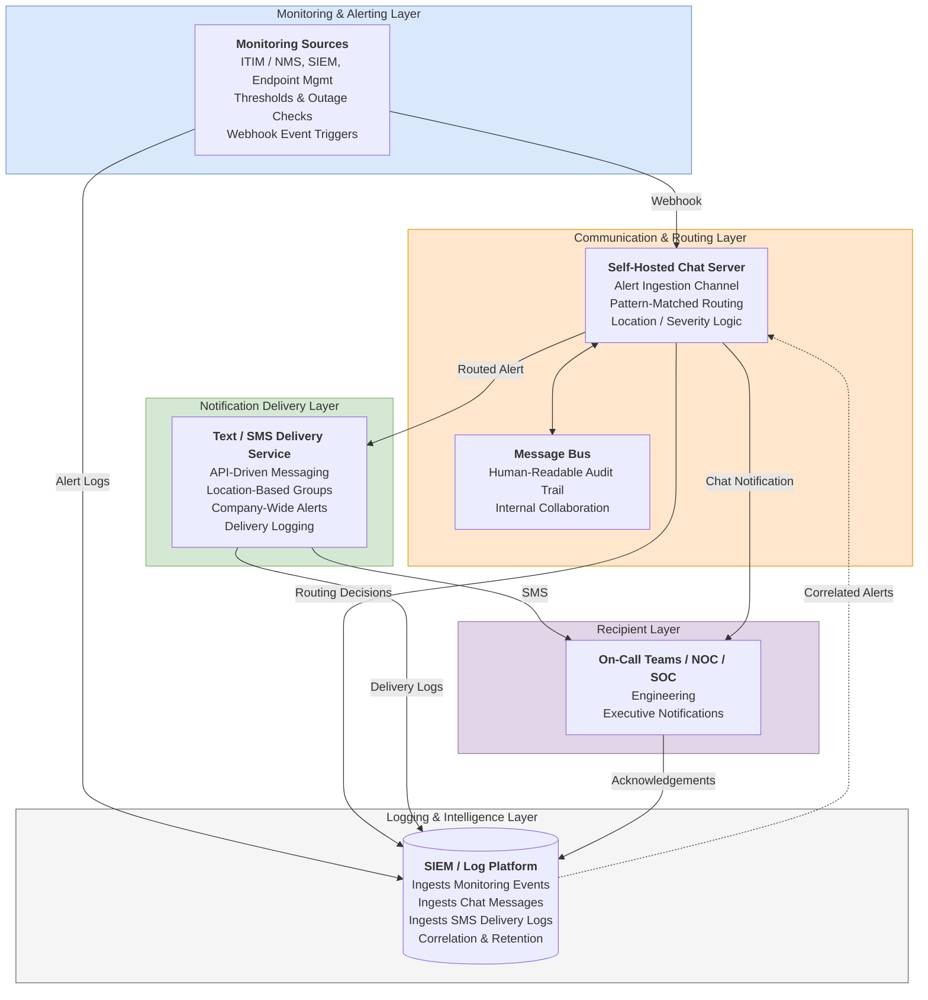

# Unified Alerting & Notification Architecture

A multi-layer alert routing, delivery and audit pipeline that restored SMS alerting after AT&T discontinued email-to-SMS, and gave the organization its first mass-alerting capability.

> **Portfolio note:** This is a sanitized write-up of a project I designed and delivered in a previous role. Organization names, hostnames, users and internal identifiers have been removed or replaced with placeholders.

**Author:** Alex Scheaffer · **Status:** Implemented and validated in production

---

## The Problem

1. **No mass-alerting capability.** There was no way to notify all staff or a specific location during a site-down or widespread outage. Communication was manual, inconsistent and slow, and there was no record of who was notified or when.
2. **Email-to-SMS stopped working.** When AT&T disabled email-to-text, every SMS alert from monitoring (Nagios), security (SIEM) and endpoint management (Atera) failed silently. On-call teams stopped hearing about outages.

## The Solution

A layered pipeline that decouples *where alerts come from* from *how they are delivered*:

| Layer | Role |
|---|---|
| **1. Monitoring & Alerting** | Monitoring, SIEM and endpoint tools emit structured webhook events instead of emails |
| **2. Communication & Routing** | A self-hosted chat server acts as a lightweight message bus: alerts land in an ingestion channel and are routed by site and severity using a predictable message pattern |
| **3. Notification Delivery** | API-driven SMS replaces email-to-SMS, with location-based groups, company-wide broadcast and per-message delivery logging |
| **4. Recipients** | On-call teams, NOC/SOC, engineering and leadership, notified according to time-based escalation rules |
| **5. Logging & Intelligence** | The SIEM ingests every event, routing decision and delivery result for correlation, retention and audit |

## Architecture



Mermaid source: [`diagrams/alerting-architecture.mmd`](diagrams/alerting-architecture.mmd) · Layer-by-layer walkthrough: [`docs/architecture.md`](docs/architecture.md)

## How an Alert Is Routed

Every alert is normalized to one human-readable, machine-parsable pattern ([full spec](docs/alert-format.md)):

```
[ALERT] [SITE=SITE-A] [SEV=CRITICAL] Database unreachable for 3 checks
```

| Severity | Delivery | Escalation if unacknowledged |
|---|---|---|
| `CRITICAL` | SMS + Chat | +5 min NOC/SOC → +10 min Engineering Leadership → +15 min Executive |
| `HIGH` | Chat | +10 min NOC/SOC |
| `MEDIUM` | Chat only | Only if repeated 3× in 30 min |
| `SITE=ALL` + `CRITICAL` | Company-wide SMS + chat broadcast | n/a |

Alerts with missing or malformed fields fall back to a default group and are logged as anomalies instead of being dropped. Duplicates within 60 seconds are suppressed, and floods are rate-limited into a summary message.

## Key Features

- Carrier-independent, API-based SMS delivery with delivery confirmation
- Site-wide and company-wide mass alerting
- Location-aware and severity-aware routing from a single message pattern
- Human-readable audit trail in the chat ingestion channel
- Time-based escalation chains, stopped by acknowledgement
- SIEM correlation across monitoring, endpoint and security events
- Graceful degradation when the chat server, SMS provider or SIEM is unavailable

## Tooling

| Role | Tool used |
|---|---|
| Infrastructure monitoring (ITIM / NMS) | Nagios |
| Endpoint management / RMM | Atera |
| Security events & log platform | SIEM |
| Routing layer / message bus | Self-hosted chat server |
| SMS delivery | SMS API provider (Twilio or equivalent) |

## My Contribution

- Identified the gaps in alerting and incident communication
- Authored both proposals: [mass alerting](docs/proposals/mass-alerting-proposal.md) and [SMS replacement](docs/proposals/sms-replacement-proposal.md)
- Designed the end-to-end architecture and recorded the [key decisions](docs/decisions/)
- Built the routing logic and webhook integrations
- Implemented the SMS delivery layer
- Integrated SIEM logging for correlation, retention and audit
- Validated the system with on-call teams and leadership

## Impact

- Restored SMS alert delivery after the AT&T email-to-SMS shutdown
- Introduced the organization's first mass-alerting capability
- Reduced alert delivery failures, and made remaining failures visible through delivery confirmation and logging
- Improved time-to-awareness for outages
- Created a repeatable model that new tools and channels can plug into without redesign

## Repository Structure

```
.
├── docs/
│   ├── architecture.md              Layer-by-layer architecture explanation
│   ├── alert-format.md              Alert pattern, payload fields and routing rules
│   ├── proposals/                   The two proposals that started the project
│   └── decisions/                   Architecture Decision Records (ADRs)
├── diagrams/
│   └── alerting-architecture.mmd    Mermaid source for the diagram above
├── examples/                        Sanitized payloads for each pipeline stage
└── validation/                      Test scenarios, test matrix and how to run them
```

## License

Documentation and examples are released under the [MIT License](LICENSE).
